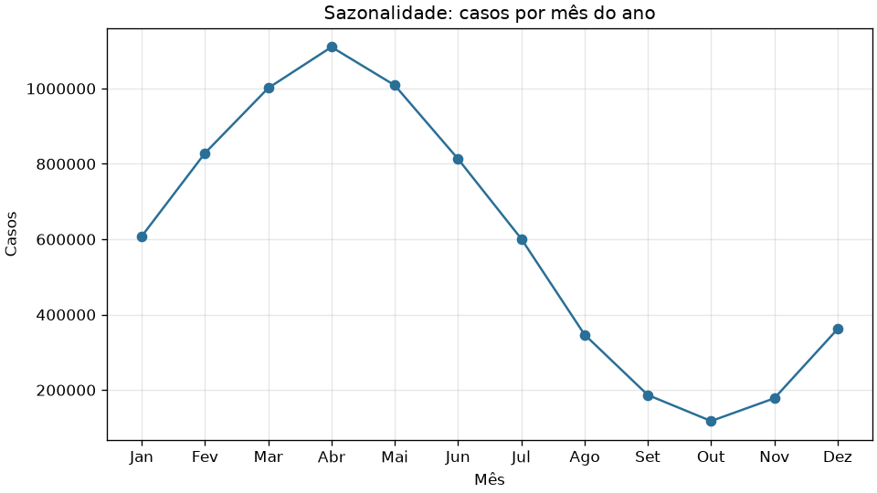

# 🦟 Painel de Dengue no Brasil


Projeto didático de **análise de dados de saúde** com Python. Lê notificações mensais de dengue por estado (2022–2025), limpa os dados, calcula indicadores, gera gráficos e mostra tudo em uma janela com filtros.

> ⚠️ **Os dados são fictícios.** Eles são gerados por um script reprodutível (semente fixa), inspirados na estrutura de notificações reais. Não use este projeto para tirar conclusões epidemiológicas.



## ✨ Funcionalidades

- Geração reprodutível de dados com sazonalidade e um ano epidêmico simulado
- Limpeza com pandas: duplicatas, textos, datas e valores ausentes
- Indicadores: total de casos, óbitos, letalidade, mês de pico e incidência por 100 mil habitantes
- 4 gráficos: casos por ano, sazonalidade, top estados por casos e por incidência
- Interface desktop (tkinter) com filtros por ano e região
- Modo terminal (`--sem-interface`) que imprime relatório e salva os PNGs
- Testes automatizados com pytest

## 🛠️ Tecnologias

| Ferramenta | Uso |
|---|---|
| Python 3.13+ | Linguagem |
| pandas | Leitura, limpeza e análise |
| matplotlib | Gráficos |
| tkinter | Interface gráfica (já vem com o Python) |
| pytest | Testes |

## 📁 Estrutura

```
src/        código-fonte (um módulo por responsabilidade)
tests/      testes automatizados
data/raw/   CSV gerado pelo script (não versionado)
outputs/    gráficos PNG salvos (não versionados)
docs/       imagens usadas neste README
.vscode/    configurações compartilhadas do VS Code
```

| Módulo | Responsabilidade |
|---|---|
| `config.py` | Constantes e caminhos |
| `gerar_dados.py` | Cria o CSV fictício |
| `carregar.py` | Lê e valida o CSV |
| `tratar.py` | Limpa e cria colunas novas |
| `analisar.py` | Calcula indicadores |
| `graficos.py` | Desenha os gráficos |
| `interface.py` | Janela tkinter |
| `main.py` | Junta tudo |

## 🚀 Como executar

### 1. Clone e entre na pasta

```bash
git clone https://github.com/SEU-USUARIO/painel-dengue.git
cd painel-dengue
```

### 2. Crie e ative o ambiente virtual

```bash
python -m venv .venv

# Linux/macOS
source .venv/bin/activate
# Windows (PowerShell)
.venv\Scripts\Activate.ps1
```

### 3. Instale as dependências

```bash
pip install -r requirements.txt
```

> No Linux (Ubuntu/Debian), se faltar o tkinter: `sudo apt install python3-tk`

### 4. Gere os dados e rode

```bash
python -m src.gerar_dados          # cria data/raw/casos_dengue.csv
python -m src.main                 # abre a interface gráfica
python -m src.main --sem-interface # relatório no terminal + PNGs em outputs/
```

Rode sempre da raiz do projeto e com `python -m`, para os imports funcionarem.

## 🧪 Testes

```bash
pytest
```

## 💻 Usando o VS Code

Ao abrir a pasta, o VS Code sugere as extensões recomendadas. Depois:

- **F5**: escolha uma configuração em *Executar e Depurar* (gerar dados, painel, relatório ou testes)
- **Ícone de frasco**: rode e depure os testes visualmente
- `Ctrl+Shift+P` → **Tasks: Run Task** para atalhos de tarefas

## 🧠 O que este projeto pratica

type hints, docstrings, `pathlib`, `logging`, `try/except` específico, `dataclass`, `argparse`, constantes de configuração, separação em camadas, `groupby` e colunas calculadas do pandas, e testes com fixtures.

## 🎯 Ideias de evolução

- [ ] Filtro por estado (UF) na interface
- [ ] Gráfico da evolução mensal de 2022 a 2025
- [ ] Exportar relatório em CSV
- [ ] Preencher valores ausentes com a mediana do estado
- [ ] Usar dados reais do OpenDataSUS ou do InfoDengue

## 📚 Fontes para dados reais

- [OpenDataSUS](https://opendatasus.saude.gov.br/): Ministério da Saúde
- [InfoDengue](https://info.dengue.mat.br/): Fiocruz/FGV
- [IBGE](https://www.ibge.gov.br/): populações oficiais

## 📄 Licença

Distribuído sob a licença MIT. Veja o arquivo [LICENSE](LICENSE).

## 👤 Autor

**Victor Freire**: [GitHub](https://github.com/victorfreireavfs)
